<div align="center">

# RECONECTA

### Mobile Client

**De la emergencia a la reconstrucción**

Aplicación móvil para la gestión de desastres y evaluación de daños en escenarios con conectividad limitada.


**Pontificia Universidad Javeriana**

Arquitectura de Software · 2026

[Plataforma completa](https://github.com/disaster-management-platform/disaster-platform-infrastructure) ·
[Arquitectura](#arquitectura) ·
[Demostración](#demostración) ·
[Instalación](#instalación-y-ejecución)

</div>

---

## Demostración

<div align="center">

[](https://youtu.be/HVCKoTRAxu8)

[Ver demostración funcional de RECONECTA](https://youtu.be/HVCKoTRAxu8)

</div>

## Descripción

`disaster-mobile-client` implementa la aplicación Android de RECONECTA, orientada al registro y consulta de información durante situaciones de emergencia en las que la infraestructura de comunicaciones puede encontrarse afectada.

La aplicación utiliza una arquitectura de presentación Model-View-ViewModel (MVVM), complementada con el patrón Repository y una estrategia Offline First.

La información se almacena inicialmente en el dispositivo mediante Room y SQLite, permitiendo realizar operaciones sin depender de una conexión permanente con los servicios centrales.

Cuando se recupera la conectividad, WorkManager coordina la sincronización de las operaciones pendientes mediante los contratos REST expuestos por el API Gateway.

La aplicación no accede directamente a las bases de datos centrales ni sustituye las reglas de negocio de los servicios propietarios.

## Contenido

- [Funcionalidades](#funcionalidades)
- [Arquitectura](#arquitectura)
- [Estrategia Offline First](#estrategia-offline-first)
- [Decisiones arquitectónicas](#decisiones-arquitectónicas)
- [Tecnologías y justificación](#tecnologías-y-justificación)
- [Estructura del repositorio](#estructura-del-repositorio)
- [Integración con otros componentes](#integración-con-otros-componentes)
- [Persistencia](#persistencia)
- [Contratos de comunicación](#contratos-de-comunicación)
- [Seguridad y gestión de identidad](#seguridad-y-gestión-de-identidad)
- [Instalación y ejecución](#instalación-y-ejecución)
- [Pruebas](#pruebas)
- [Repositorios relacionados](#repositorios-relacionados)
- [Autores](#autores)

## Funcionalidades

| Funcionalidad | Descripción |
|---|---|
| Registro de desastres | Captura de información desde dispositivos móviles. |
| Geolocalización | Obtención de coordenadas mediante los servicios de ubicación del dispositivo. |
| Visualización cartográfica | Representación de desastres mediante marcadores y radios de afectación. |
| Clasificación | Consulta local del catálogo de tipos de desastre. |
| Operación Offline First | Registro y consulta de información previamente almacenada sin conectividad. |
| Sincronización automática | Procesamiento de operaciones pendientes mediante WorkManager. |
| Sincronización incremental | Descarga de cambios mediante cursores y paginación. |
| Gestión de conflictos | Identificación de operaciones incompatibles sin sobrescribir silenciosamente los datos. |
| Evaluación de daños | Registro local de evaluaciones y evidencias mediante el módulo disponible en Debug. |
| Evidencias | Almacenamiento privado, verificación de integridad y sincronización de archivos. |

### Alcance funcional

La aplicación móvil prioriza las actividades realizadas por funcionarios y brigadas en campo.

Las operaciones administrativas, la consolidación de reportes y la gestión completa de proyectos de reconstrucción permanecen en la aplicación web y los servicios propietarios.

El módulo móvil de evaluación de daños se encuentra disponible en la variante Debug, con una sesión previamente validada mediante un JWT externo. La autenticación interactiva OIDC completa y su habilitación en Release requieren integración adicional.

## Arquitectura

### Estilo y patrón arquitectónico

La aplicación forma parte de la Service-Based Architecture de RECONECTA como cliente móvil independiente.

Internamente, utiliza:

- Model-View-ViewModel (MVVM).
- Repository Pattern.
- Offline First.
- Inyección de dependencias.
- Programación reactiva.
- Procesamiento asíncrono.
- Sincronización mediante lotes y cambios incrementales.

### Vista lógica

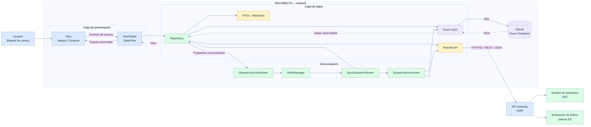

### Responsabilidades de MVVM

| Elemento | Implementación | Responsabilidad |
|---|---|---|
| View | Jetpack Compose | Representar interfaces y capturar las interacciones del usuario. |
| ViewModel | `FormViewModel`, `DisastersViewModel` | Administrar el estado de presentación y coordinar las operaciones con el repositorio. |
| Model | Repository, entidades, DTOs y fuentes de datos | Administrar la información local y la comunicación con los servicios remotos. |

Los componentes visuales observan el estado proporcionado por los ViewModels mediante StateFlow y `collectAsStateWithLifecycle`.

La interfaz no depende directamente de Retrofit ni ejecuta consultas SQL.

### Componentes internos

| Componente | Responsabilidad |
|---|---|
| `FormViewModel` | Administrar el formulario, validar entradas y solicitar el registro local. |
| `DisastersViewModel` | Exponer los desastres almacenados y gestionar las actualizaciones. |
| `DisasterRepository` | Coordinar la persistencia local y la descarga de información remota. |
| `DisasterDao` | Ejecutar consultas y operaciones transaccionales sobre Room. |
| `DisasterDatabase` | Configurar la base SQLite y sus migraciones. |
| `DisasterApi` | Definir los contratos REST del servicio de Desastres. |
| `DisasterSyncScheduler` | Programar los trabajos de sincronización. |
| `SyncDisastersWorker` | Ejecutar la sincronización en segundo plano. |
| `DisasterSynchronizer` | Procesar lotes pendientes, confirmaciones y conflictos. |
| `AssessmentRepository` | Administrar evaluaciones, catálogos y evidencias locales. |
| `AssessmentSessionManager` | Administrar las sesiones previamente validadas para evaluación de daños. |
| `GatewayBearerInterceptor` | Incorporar tokens vigentes exclusivamente a solicitudes dirigidas al Gateway configurado. |
| `NetworkModule` | Configurar Retrofit y los clientes de comunicación. |
| `DatabaseModule` | Proporcionar las instancias compartidas de Room y DAO. |

### Arquitectura reactiva

La base de datos local constituye la fuente inmediata de información para las interfaces.

Las actualizaciones locales y las realizadas durante la sincronización se reflejan en la presentación mediante flujos observables.

```mermaid
%%{init: {"theme":"base","themeVariables":{"background":"#ffffff","lineColor":"#64748b"},"flowchart":{"curve":"linear"}}}%%
flowchart LR

    DB[("Room
    SQLite")]

    DAO["DAO"]

    R["Repository"]

    VM["ViewModel"]

    UI["Compose UI"]

    U["Usuario"]

    DB -->|"Cambios persistidos"| DAO

    DAO -->|"Flow"| R

    R -->|"Flow"| VM

    VM -->|"StateFlow"| UI

    UI -->|"Representación"| U

    U -->|"Eventos"| UI

    UI -->|"Acciones"| VM

    VM -->|"Corrutinas"| R

    R -->|"Operaciones de escritura"| DAO

    DAO --> DB

    classDef presentation fill:#DBEAFE,stroke:#7B9ABD,color:#19363F;
    classDef logic fill:#DCFCE7,stroke:#86B49A,color:#19363F;
    classDef storage fill:#EDE9FE,stroke:#AA98CD,color:#19363F;

    class UI,U,VM presentation;
    class R logic;
    class DB,DAO storage;
```

Este enfoque evita que las vistas dependan de respuestas HTTP para actualizar su estado y permite mantener disponibles las consultas locales cuando se pierde la conectividad.

### Vista de procesos

La aplicación se ejecuta dentro del proceso Android correspondiente al dispositivo.

Las interfaces Compose y los ViewModels administran las interacciones del usuario, mientras que las corrutinas y WorkManager coordinan las operaciones de persistencia y comunicación.

WorkManager administra trabajos persistentes en segundo plano, sujetos a las restricciones del sistema operativo y a la disponibilidad de conectividad.

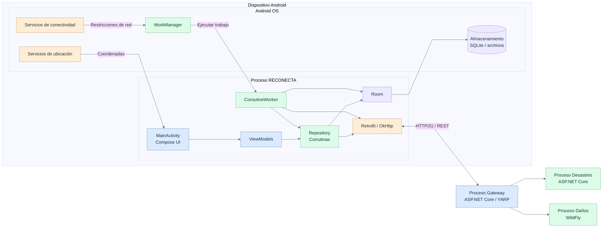

Las operaciones en segundo plano no requieren mantener abierta la pantalla desde la cual se creó el reporte.

Sin embargo, su ejecución depende de las restricciones de Android y no constituye una garantía de sincronización inmediata.

## Estrategia Offline First

### Principio de funcionamiento

La disponibilidad de la aplicación en campo no debe depender exclusivamente de la disponibilidad de los servicios centrales.

Por esta razón, el registro de un desastre se realiza inicialmente mediante una operación local.

Cada reporte recibe un UUID que se conserva junto con el contenido original de creación durante todo su ciclo de sincronización.

La confirmación presentada después del registro indica que los datos quedaron almacenados en el dispositivo, no necesariamente que fueron recibidos o procesados por el servidor.

### Registro sin conexión

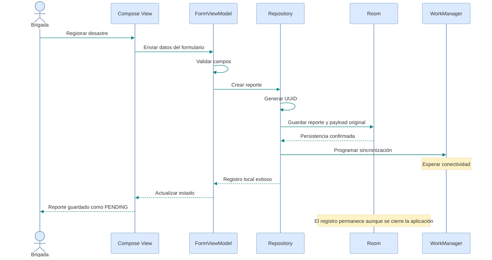

El registro local no necesita una respuesta del Gateway ni del servicio de Desastres.

### Sincronización después de recuperar conectividad

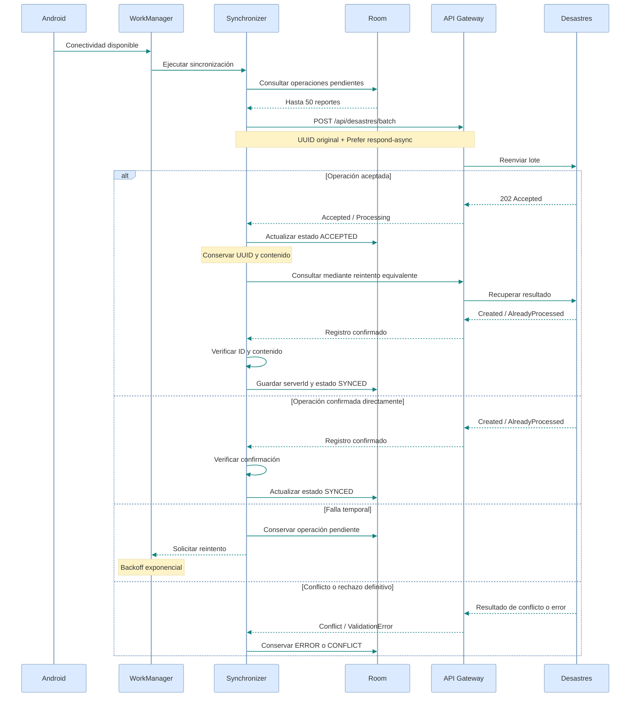

La aceptación durable de una operación no equivale a su procesamiento definitivo.

El estado `SYNCED` únicamente se asigna después de comprobar una confirmación válida del servicio propietario.

### Estados de sincronización

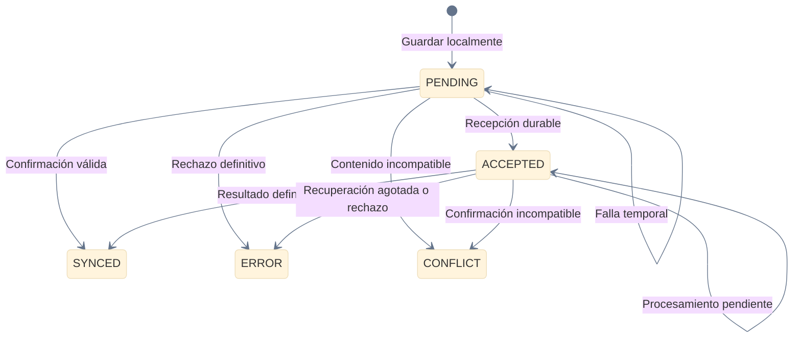

| Estado | Significado |
|---|---|
| `PENDING` | Información persistida localmente y pendiente de procesamiento remoto. |
| `ACCEPTED` | El servidor confirmó la recepción, pero todavía no el resultado definitivo. |
| `SYNCED` | Operación confirmada y asociada a un identificador remoto. |
| `ERROR` | Rechazo definitivo que requiere revisión. |
| `CONFLICT` | Incompatibilidad entre el contenido local y el reconocido por el servidor. |

### Recuperación de operaciones

La sincronización utiliza una cadena de trabajo única denominada `sync-disasters`.

WorkManager programa las operaciones bajo una restricción de conectividad, mediante la política `APPEND_OR_REPLACE`.

Los fallos recuperables utilizan backoff exponencial con un intervalo inicial de 30 segundos.

La aplicación vuelve a programar la sincronización al iniciar su proceso, permitiendo recuperar operaciones que quedaron persistidas antes de que el trabajo pudiera programarse.

Los UUID no se regeneran durante los reintentos.

Los conflictos y errores definitivos se conservan para revisión. La aplicación no crea nuevas operaciones automáticamente para ocultar un conflicto.

### Sincronización incremental

Las consultas remotas se realizan mediante un mecanismo Delta basado en cursores.

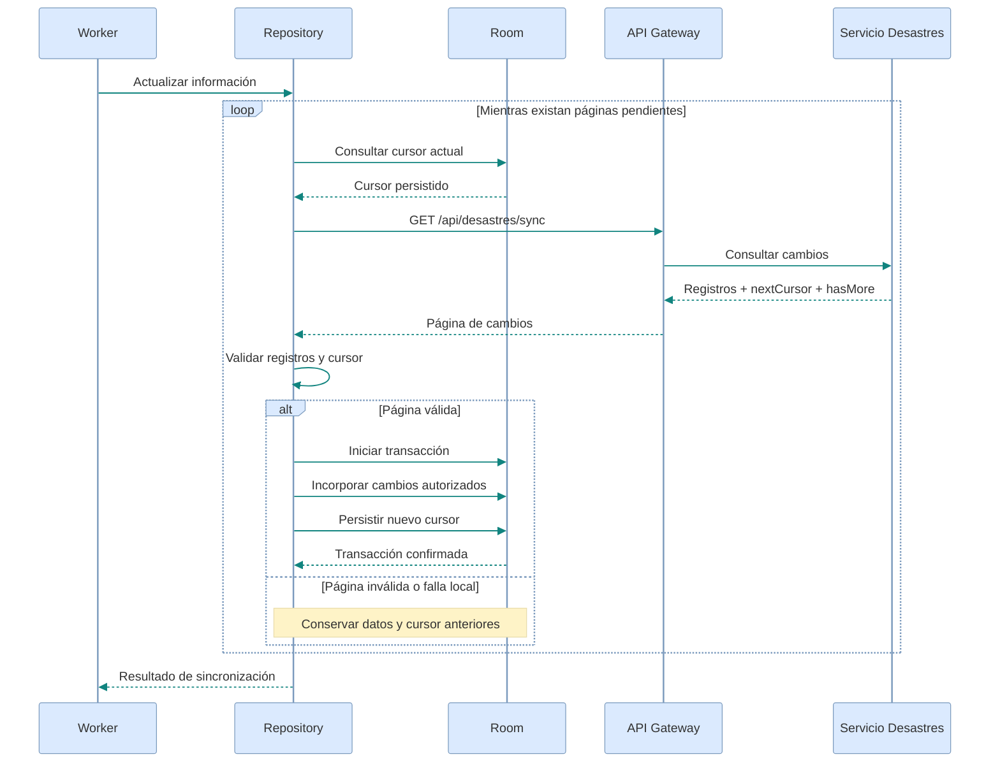

Los cambios se descargan en páginas de hasta 50 registros.

Cada página y su cursor se almacenan dentro de una misma transacción local, evitando avanzar el progreso cuando la persistencia no se ha completado.

La sincronización no reemplaza automáticamente operaciones pendientes, conflictos ni versiones más recientes.

### Sincronización de evaluaciones y evidencias

El módulo de evaluación de daños disponible en Debug permite conservar evaluaciones y archivos en el dispositivo.

Los archivos se almacenan como copias privadas, acompañados de metadatos que identifican su tamaño, tipo e integridad mediante SHA-256.

La evaluación y sus evidencias se sincronizan en fases independientes.

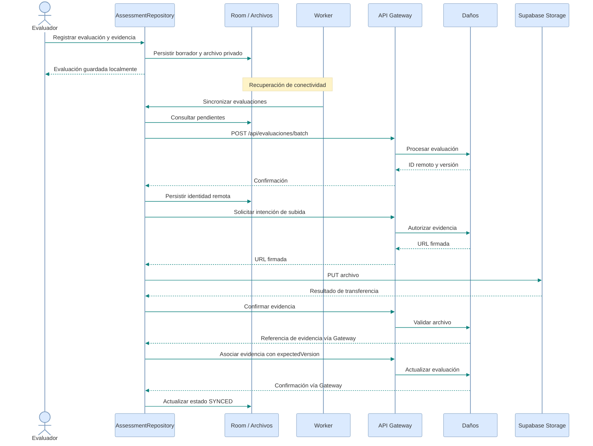

Si ocurre una falla durante la transferencia de un archivo, la aplicación conserva la identidad remota de la evaluación.

El siguiente intento recupera el estado de la evidencia antes de repetir una operación incierta, evitando volver a crear innecesariamente la evaluación.

| Estado de evaluación | Significado |
|---|---|
| `PENDING` | Borrador u operación pendiente de sincronización. |
| `UPLOADING_EVIDENCE` | Evaluación remota registrada, con evidencias pendientes. |
| `SYNCED` | Evaluación confirmada y referencias de evidencias asociadas. |
| `ERROR` | Operación rechazada o que requiere revisión. |
| `CONFLICT` | Incompatibilidad de contenido o versión. |

Se admiten archivos JPEG, PNG y PDF de hasta 6 MiB por evidencia.

## Decisiones arquitectónicas

| Atributo de calidad | Decisión arquitectónica | Tácticas y mecanismos |
|---|---|---|
| Disponibilidad | Arquitectura Offline First | Persistencia local y consulta sin conectividad. |
| Resiliencia | Separación entre registro y transmisión | WorkManager y recuperación de operaciones pendientes. |
| Interoperabilidad | Comunicación mediante contratos explícitos | Retrofit, REST, JSON y API Gateway. |
| Escalabilidad | Procesamiento agrupado de operaciones | Envío por lotes y consultas paginadas. |
| Rendimiento | Utilización de una fuente local de datos | Room, SQLite y actualización incremental. |
| Modificabilidad | Model-View-ViewModel | Separación de presentación, estado y datos. |
| Modificabilidad | Repository Pattern | Abstracción de las fuentes de información. |
| Integridad | Identificadores estables | UUID, idempotencia, versiones y SHA-256. |
| Recuperabilidad | Persistencia transaccional | Conservación de operaciones, archivos y cursores. |
| Seguridad | Protección de identidad móvil | Android Keystore y validación remota de tokens. |
| Usabilidad | Interfaces reactivas | Jetpack Compose, Flow y StateFlow. |

### Trade-offs

| Decisión | Beneficio | Compromiso |
|---|---|---|
| Offline First | Permite continuar trabajando sin conexión. | Introduce consistencia eventual y mecanismos de reconciliación. |
| Persistencia local | Reduce la dependencia de la red. | Requiere migraciones y protección de datos en el dispositivo. |
| Envío por lotes | Reduce la cantidad de solicitudes al servidor. | Requiere gestionar resultados parciales y reintentos individuales. |
| WorkManager | Permite recuperar trabajos pendientes. | El sistema operativo determina el momento efectivo de ejecución. |
| Sincronización Delta | Reduce el volumen de información transferida. | Requiere conservar y validar cursores. |
| Almacenamiento separado de evidencias | Permite recuperar transferencias interrumpidas. | Introduce varias fases de sincronización. |
| Identidad previamente validada | Permite operar con datos autorizados durante desconexiones. | No permite conocer inmediatamente una revocación remota mientras el dispositivo está offline. |

## Tecnologías y justificación

### Kotlin


Kotlin proporciona las capacidades necesarias para desarrollar aplicaciones Android mediante tipado estático, corrutinas y programación reactiva.

Su utilización facilita implementar operaciones de comunicación y persistencia asíncronas sin bloquear la interfaz de usuario.

La integración mediante REST permite conservar independencia tecnológica frente a los servicios desarrollados en .NET y Jakarta EE.

### Jetpack Compose


Jetpack Compose proporciona un modelo declarativo para construir interfaces a partir del estado observable de la aplicación.

Su selección se alinea con MVVM, permitiendo que formularios, listados y mapas reflejen los cambios realizados sobre la persistencia local.

Este comportamiento resulta especialmente conveniente para representar los estados de sincronización sin depender de actualizaciones manuales de los componentes visuales.

### Room y SQLite


Room proporciona una abstracción sobre SQLite mediante entidades, DAO, consultas observables y migraciones de esquema.

Su selección responde directamente a la necesidad de conservar información cuando los servicios centrales no están disponibles.

La persistencia local permite almacenar los datos de los formularios, identificadores de operaciones, estados de sincronización, catálogos y cursores sin depender de una conexión permanente.

Las migraciones permiten evolucionar el modelo local conservando los reportes previamente almacenados.

### WorkManager


WorkManager administra operaciones persistentes en segundo plano.

Se seleccionó para desacoplar la interacción del usuario del proceso de sincronización con los servicios centrales.

Permite establecer restricciones de conectividad, reintentos, políticas de espera y cadenas de trabajo que sobreviven al cierre ordinario de la aplicación.

Esta integración favorece la recuperabilidad de operaciones generadas durante situaciones de emergencia.

### Retrofit y OkHttp


Retrofit proporciona una abstracción de los contratos HTTP mediante interfaces y anotaciones.

OkHttp administra la comunicación de red y permite incorporar interceptores especializados para la propagación de tokens.

Esta combinación facilita integrar la aplicación Android con las APIs de Desastres y Evaluación de Daños, independientemente de los lenguajes y tecnologías utilizados por los servidores.

Los contratos REST, JSON y Multipart mantienen la comunicación desacoplada de las implementaciones de negocio.

### Gson


Gson permite serializar y deserializar los objetos intercambiados mediante los contratos REST.

Su utilización permite conservar el contenido original de las operaciones de creación para posteriores reintentos.

Esta característica contribuye a la consistencia de las solicitudes y a la identificación de operaciones previamente procesadas.

### Hilt


Hilt proporciona mecanismos de inyección de dependencias sobre Dagger.

Permite administrar las instancias de Room, Retrofit, repositorios, ViewModels y Workers sin acoplar directamente la presentación con sus implementaciones.

La integración con WorkManager permite proporcionar dependencias a los trabajadores encargados de sincronizar las operaciones pendientes.

Su selección favorece la modificabilidad y las pruebas independientes de los componentes.

### Kotlin Coroutines, Flow y StateFlow

Las corrutinas permiten ejecutar operaciones asíncronas de persistencia y comunicación.

Flow y StateFlow permiten representar los cambios producidos sobre la información local como flujos observables.

Su integración con Room y Compose facilita implementar una presentación reactiva que refleja el estado vigente de los reportes sin realizar consultas HTTP desde las vistas.

### Google Maps SDK


Google Maps SDK permite representar geográficamente los desastres registrados.

Su integración con los servicios de ubicación de Android permite obtener coordenadas y visualizar puntos correspondientes a las zonas afectadas.

El radio de afectación se conserva como un atributo del reporte y se representa gráficamente cuando existe información disponible.

Las coordenadas y reportes previamente almacenados permanecen disponibles localmente, aunque la disponibilidad de las imágenes cartográficas depende de la conectividad y caché del proveedor.

### Android Keystore


Android Keystore proporciona mecanismos de protección de claves criptográficas en el dispositivo.

Se utiliza para proteger la clave AES empleada en el cifrado de la sesión del módulo de evaluación de daños.

Esta integración permite conservar sesiones previamente validadas sin almacenar tokens en archivos de configuración públicos o incorporarlos al código fuente.

### Gradle


Gradle administra la construcción de la aplicación, las dependencias, las variantes Debug y Release y la configuración de los endpoints.

Permite generar artefactos Android independientes del despliegue de los servicios centrales.

La dirección del Gateway puede configurarse durante la compilación, facilitando la integración con diferentes entornos sin modificar el código fuente de los repositorios de negocio.

## Estructura del repositorio

La aplicación se organiza bajo el paquete:

`co.edu.javeriana.disasterplatform.disaster_mobile_client`

Estructura principal:

```text
disaster-mobile-client/
│
├── app/
│   ├── schemas/
│   │
│   ├── src/
│   │   ├── main/
│   │   │   ├── java/
│   │   │   │   └── .../disaster_mobile_client/
│   │   │   │       ├── data/
│   │   │   │       │   ├── assessments/
│   │   │   │       │   ├── dto/
│   │   │   │       │   ├── local/
│   │   │   │       │   ├── remote/
│   │   │   │       │   ├── repository/
│   │   │   │       │   ├── sync/
│   │   │   │       │   └── ReportValidation.kt
│   │   │   │       │
│   │   │   │       ├── di/
│   │   │   │       │   ├── DatabaseModule.kt
│   │   │   │       │   └── NetworkModule.kt
│   │   │   │       │
│   │   │   │       ├── navigation/
│   │   │   │       │   └── AppNavigation.kt
│   │   │   │       │
│   │   │   │       ├── ui/
│   │   │   │       │   ├── screens/
│   │   │   │       │   ├── theme/
│   │   │   │       │   └── viewmodels/
│   │   │   │       │
│   │   │   │       ├── DisasterApplication.kt
│   │   │   │       └── MainActivity.kt
│   │   │   │
│   │   │   ├── res/
│   │   │   └── AndroidManifest.xml
│   │   │
│   │   ├── debug/
│   │   ├── test/
│   │   └── androidTest/
│   │
│   └── build.gradle.kts
│
├── gradle/
├── gradlew
├── gradlew.bat
├── build.gradle.kts
├── gradle.properties
├── settings.gradle.kts
├── .gitignore
└── README.md
```

### Responsabilidad de los paquetes

| Paquete | Responsabilidad |
|---|---|
| `data/local` | Entidades, DAO, base de datos y migraciones. |
| `data/remote` | Contratos Retrofit e interceptores HTTP. |
| `data/dto` | Objetos de transferencia de información. |
| `data/repository` | Coordinación entre fuentes locales y remotas. |
| `data/sync` | Programación y ejecución de sincronización. |
| `data/assessments` | Persistencia y sincronización de evaluaciones y evidencias. |
| `di` | Configuración de inyección de dependencias. |
| `navigation` | Navegación entre pantallas. |
| `ui/screens` | Interfaces implementadas mediante Compose. |
| `ui/viewmodels` | Estado y lógica de presentación. |
| `ui/theme` | Identidad visual y estilos. |
| `src/debug` | Componentes exclusivos del entorno de desarrollo. |
| `src/test` | Pruebas unitarias y locales. |
| `src/androidTest` | Pruebas instrumentadas sobre Android. |

## Integración con otros componentes

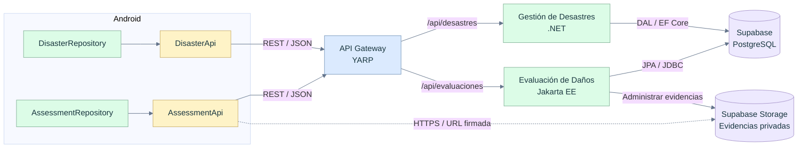

| Componente externo | Relación con Android |
|---|---|
| API Gateway | Punto central de consumo de los contratos de negocio. |
| Gestión de Desastres | Registro, procesamiento de lotes, catálogos y sincronización incremental. |
| Evaluación de Daños | Registro de evaluaciones, validación de sesión y gestión de evidencias. |
| Supabase Storage | Transferencia de archivos mediante URLs firmadas autorizadas por el servicio propietario. |
| Keycloak | Proveedor de identidad de la plataforma. |
| Google Maps | Representación cartográfica de los eventos registrados. |

La aplicación no mantiene credenciales de conexión directa a PostgreSQL.

La transferencia directa de evidencias hacia Storage se realiza únicamente mediante los mecanismos autorizados por Evaluación de Daños.

## Persistencia

### Base de datos local

La aplicación utiliza Room sobre SQLite.

La versión actual del esquema local es la 5, incorporando migraciones incrementales desde las versiones anteriores.

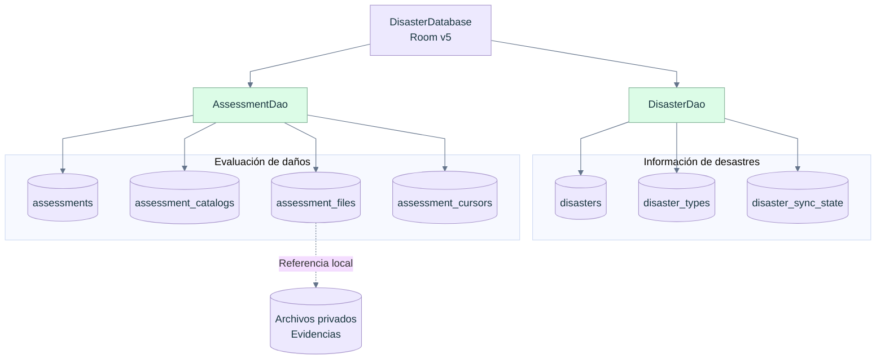

| Entidad o estructura | Responsabilidad |
|---|---|
| `DisasterEntity` | Información local y remota de los desastres. |
| `DisasterTypeEntity` | Catálogo de tipos de desastre. |
| `DisasterSyncState` | Cursores de sincronización incremental. |
| `LocalAssessment` | Evaluaciones locales, contenido original e identidad remota. |
| `AssessmentCatalog` | Catálogos de evaluación. |
| `AssessmentFile` | Metadatos y referencias de evidencias. |
| `AssessmentCursor` | Progreso de sincronización por identidad y alcance. |

### Identidad de las operaciones

Cada reporte conserva:

- UUID local.
- Identificador remoto, cuando existe.
- Contenido original de creación.
- Estado de sincronización.
- Versión remota.
- Información sobre errores o conflictos.

Esta separación permite recuperar una operación después de una falla de comunicación sin generar una nueva identidad.

### Migraciones

| Migración | Responsabilidad |
|---|---|
| 1 → 2 | Incorporación de atributos de clasificación, versión y contenido original. |
| 2 → 3 | Incorporación del estado de sincronización incremental. |
| 3 → 4 | Incorporación de referencias organizacionales y geográficas. |
| 4 → 5 | Incorporación de evaluaciones, catálogos, evidencias y cursores asociados. |

Las migraciones conservan los UUID, identificadores remotos, radios, estados y operaciones pendientes.

No se utiliza la eliminación de la base de datos como estrategia habitual de actualización.

## Contratos de comunicación

### Gestión de Desastres

| Método | Endpoint | Responsabilidad |
|---|---|---|
| GET | `/api/tipos-desastre` | Descargar el catálogo de tipos. |
| GET | `/api/desastres` | Consultar desastres autorizados. |
| POST | `/api/desastres` | Crear un desastre individual mediante el contrato disponible. |
| POST | `/api/desastres/batch` | Procesar operaciones pendientes por lotes. |
| GET | `/api/desastres/sync` | Descargar cambios mediante cursores. |

El Worker utiliza principalmente el contrato Batch para sincronizar los registros pendientes.

### Evaluación de Daños

| Método | Endpoint | Responsabilidad |
|---|---|---|
| GET | `/api/evaluaciones/catalogos` | Obtener catálogos. |
| POST | `/api/evaluaciones/batch` | Sincronizar evaluaciones. |
| GET | `/api/evaluaciones/sync` | Descargar cambios incrementales. |
| GET | `/api/evaluaciones/{id}` | Consultar una evaluación. |
| PUT | `/api/evaluaciones/{id}` | Actualizar una evaluación. |
| POST | `/api/evaluaciones/{id}/evidencias` | Solicitar una intención de subida. |
| GET | `/api/evaluaciones/{id}/evidencias/{file}` | Consultar el estado de una evidencia. |
| POST | `/api/evaluaciones/{id}/evidencias/{file}/confirmar` | Confirmar una evidencia. |
| GET | `/api/evaluaciones/{id}/evidencias/{file}/descarga` | Obtener una URL autorizada de descarga. |

### Mecanismos de comunicación

| Mecanismo | Propósito |
|---|---|
| REST / JSON | Intercambio de información con servicios heterogéneos. |
| UUID | Identificación persistente de operaciones. |
| `Idempotency-Key` | Identificación de solicitudes individuales y operaciones de evidencias. |
| `clientRequestId` | Correlación de operaciones dentro de los lotes de desastres. |
| `Prefer: respond-async` | Solicitud de procesamiento asíncrono de lotes. |
| Cursor | Identificación del progreso de sincronización incremental. |
| `expectedVersion` | Control de concurrencia. |
| SHA-256 | Verificación de integridad de archivos. |
| URL firmada | Transferencia autorizada de evidencias. |

### Ejemplo de reporte

```json
{
  "nombre": "Deslizamiento de tierra",
  "ubicacion": "Manizales, Caldas",
  "severidad": 4,
  "descripcion": "Material sobre una vía de acceso.",
  "latitud": 5.0689,
  "longitud": -75.5174,
  "radio": 500,
  "disasterTypeId": 4,
  "attentionLevel": 3
}
```

El radio es opcional y se expresa en metros.

Cuando no se conoce su valor, se conserva como `null`, evitando asignar automáticamente una delimitación que no fue registrada por el usuario.

La severidad y el nivel de atención corresponden a clasificaciones independientes.

## Seguridad y gestión de identidad

La aplicación implementa mecanismos de protección de sesiones, separación de información de evaluaciones por identidad y comunicación autorizada con el Gateway.

### Protección de la sesión

El módulo `AssessmentSessionManager` administra sesiones previamente validadas por el servicio propietario.

La información de identidad se conserva mediante un archivo privado cifrado con AES-GCM y una clave protegida por Android Keystore.

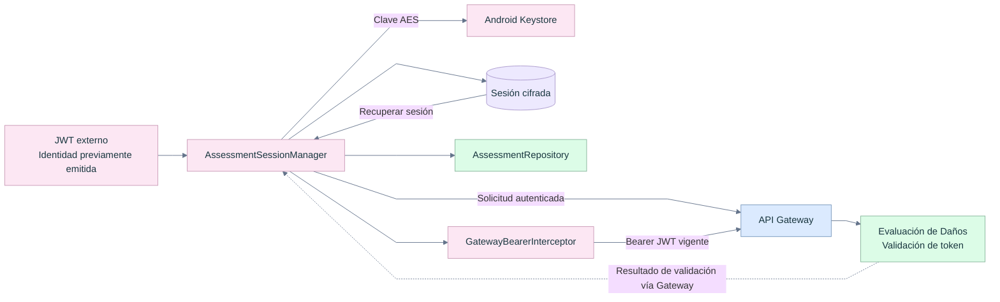

| Mecanismo | Responsabilidad |
|---|---|
| JWT | Representar una identidad y sus permisos asociados. |
| Android Keystore | Proteger la clave criptográfica de sesión. |
| AES-GCM | Proteger la información almacenada de la sesión. |
| `AssessmentSessionManager` | Validar y recuperar sesiones del módulo de evaluación. |
| `GatewayBearerInterceptor` | Limitar la propagación automática del token al Gateway configurado. |
| HTTPS | Proteger la comunicación en entornos de entrega. |
| Aislamiento de evaluaciones | Separar datos, evidencias y cursores según identidad y organización. |

Los tokens no deben incorporarse al APK, archivos Gradle, repositorios ni registros de ejecución.

Las URLs firmadas de Storage no reciben el JWT de acceso al Gateway.

La protección criptográfica de la sesión no implica que toda la base SQLite utilice cifrado adicional ni que todas las funcionalidades compartan el mismo mecanismo de aislamiento.

### Identidad y operación offline

Una sesión previamente validada permite recuperar y consultar las evaluaciones locales correspondientes al alcance autorizado.

La sincronización remota requiere un token vigente.

Las credenciales y la autorización definitiva son administradas por los servicios propietarios.

Actualmente, la importación de JWT externos se encuentra disponible mediante la interfaz de evaluación de daños en Debug. El flujo interactivo Authorization Code con PKCE pertenece a la integración futura del cliente móvil y no debe confundirse con la importación ya implementada.

## Instalación y ejecución

### Despliegue de la plataforma

La infraestructura y los servicios centrales se documentan en:

**[disaster-platform-infrastructure](https://github.com/disaster-management-platform/disaster-platform-infrastructure)**

La aplicación Android se distribuye como APK y se ejecuta independientemente de los contenedores servidores.

### Prerrequisitos

- Android Studio.
- Android SDK 37.
- JDK 25 para Gradle.
- Git.
- Emulador Android o dispositivo físico.
- Android 7.1 o superior, API 25.
- API Gateway disponible.
- Clave de Google Maps para visualización cartográfica.

### Clonar el repositorio

```bash
git clone https://github.com/disaster-management-platform/disaster-mobile-client.git

cd disaster-mobile-client
```

### Configurar Google Maps

Agregar al archivo local `local.properties`:

```properties
MAPS_API_KEY=TU_CLAVE_DE_GOOGLE_MAPS
```

La clave debe configurarse con las restricciones correspondientes a la aplicación Android.

El archivo `local.properties` no debe incorporarse al control de versiones.

### Configurar el API Gateway

La dirección predeterminada para el emulador Android es:

```text
http://10.0.2.2:5080/api/
```

La dirección `10.0.2.2` permite acceder desde el emulador a los servicios ejecutados en el computador anfitrión.

La URL base debe finalizar en `/api/`.

| Entorno | Ejemplo de dirección |
|---|---|
| Emulador Android | `http://10.0.2.2:5080/api/` |
| Dispositivo conectado a la red local | `http://192.168.1.100:5080/api/` |
| Entorno de entrega | `https://gateway.example.org/api/` |

Las direcciones de red local y entrega son ejemplos y deben sustituirse por las correspondientes al entorno real.

### Compilar la aplicación

```bash
./gradlew :app:assembleDebug
```

El APK generado se encuentra en:

```text
app/build/outputs/apk/debug/app-debug.apk
```

### Instalar en el emulador

Iniciar previamente un dispositivo virtual desde Android Studio.

Después ejecutar:

```bash
./gradlew :app:installDebug
```

También puede instalarse directamente mediante Android Debug Bridge:

```bash
adb install -r app/build/outputs/apk/debug/app-debug.apk
```

### Instalar en un dispositivo físico

Conectar el teléfono al computador, habilitar la depuración USB y verificar la conexión:

```bash
adb devices
```

Compilar e instalar indicando la dirección real del Gateway:

```bash
./gradlew :app:installDebug \
  -PAPI_BASE_URL=http://192.168.1.100:5080/api/
```

El teléfono debe poder acceder al host y puerto configurados.

El Gateway debe disponer de una interfaz de escucha accesible, configuración de hosts autorizados y reglas de red compatibles con el entorno.

HTTP se admite únicamente en entornos de desarrollo controlados. No debe utilizarse para transmitir credenciales reales en redes no confiables.

### Ejecutar la aplicación

```bash
adb shell monkey \
  -p co.edu.javeriana.disasterplatform.disaster_mobile_client \
  1
```

### Compilación para un entorno HTTPS

```bash
./gradlew :app:assembleDebug \
  -PAPI_BASE_URL=https://gateway.example.org/api/
```

Para una demostración privada que utilice una autoridad certificadora propia, la variante Debug admite una CA pública de confianza configurada externamente:

```bash
./gradlew :app:assembleDebug \
  -PAPI_BASE_URL=https://gateway.example.org/api/ \
  -PDEPLOYMENT_CA_FILE=/ruta/ca-publica.crt
```

Esta configuración no permite HTTP ni desactiva la verificación de certificados.

### Compilar Release

```bash
./gradlew :app:assembleRelease \
  -PAPI_BASE_URL=https://gateway.example.org/api/
```

La variante Release exige una dirección HTTPS.

La distribución definitiva requiere configurar la firma del APK mediante credenciales externas protegidas.

El módulo de evaluación de daños disponible en Debug no está habilitado en la variante Release actual.

## Pruebas

### Escenarios de validación

| Escenario | Criterio de aceptación |
|---|---|
| Registro offline | El reporte se almacena sin realizar una solicitud HTTP obligatoria. |
| Persistencia | Los registros permanecen después de cerrar y abrir la aplicación. |
| Idempotencia | Los reintentos conservan UUID y contenido original. |
| Sincronización | Los registros válidos se asocian a su identificador remoto. |
| Recepción asíncrona | Una operación aceptada no se marca prematuramente como sincronizada. |
| Falla de red | Los registros pendientes se conservan para posteriores reintentos. |
| Conflictos | Las operaciones incompatibles permanecen identificadas. |
| Delta | El cursor avanza únicamente después de una persistencia válida. |
| Migraciones | Los cambios de esquema mantienen la información previamente almacenada. |
| Reactividad | Las interfaces reflejan cambios realizados en Room. |
| Evidencias | Los archivos mantienen su identidad e integridad. |
| Identidad | Las evaluaciones se presentan según la identidad y alcance previamente validados. |

### Pruebas unitarias

```bash
./gradlew :app:testDebugUnitTest
```

### Compilación y pruebas locales

```bash
./gradlew :app:testDebugUnitTest :app:assembleDebug
```

### Pruebas instrumentadas

Con un emulador o dispositivo Android disponible:

```bash
./gradlew :app:connectedDebugAndroidTest
```

### Pruebas específicas

```bash
./gradlew :app:testDebugUnitTest \
  --tests '*OfflineDisastersTest'
```

```bash
./gradlew :app:testDebugUnitTest \
  --tests '*OfflineAssessmentsTest'
```

```bash
./gradlew :app:testDebugUnitTest \
  --tests '*GatewayBearerInterceptorTest'
```

### Componentes de prueba

| Archivo | Responsabilidad |
|---|---|
| `OfflineDisastersTest.kt` | Persistencia local, reintentos, lotes y sincronización incremental. |
| `OfflineAssessmentsTest.kt` | Evaluaciones offline, archivos, conflictos y sincronización. |
| `GatewayBearerInterceptorTest.kt` | Restricciones de propagación de tokens. |
| `OfflineGatewayInstrumentedTest.kt` | Integración móvil con el Gateway. |
| `OfflineAssessmentInstrumentedTest.kt` | Flujo de evaluación y evidencias en condiciones de desconexión. |
| `ReactiveBindingInstrumentedTest.kt` | Comportamiento reactivo de las interfaces. |

### Validación manual Offline First

1. Iniciar la infraestructura y comprobar el funcionamiento del Gateway.
2. Abrir la aplicación Android.
3. Configurar una identidad válida cuando el contrato remoto lo requiera.
4. Descargar los catálogos necesarios.
5. Desactivar la conexión Wi-Fi y los datos móviles.
6. Registrar un desastre ficticio.
7. Verificar que el reporte aparezca como `PENDING`.
8. Cerrar y volver a abrir la aplicación.
9. Confirmar que la información permanece almacenada.
10. Recuperar la conectividad.
11. Permitir que WorkManager ejecute la sincronización.
12. Verificar la transición a `SYNCED` después de recibir la confirmación definitiva.
13. Consultar el desastre desde la aplicación web.
14. Comprobar que existe un único registro correspondiente a la operación.

### Validación de recuperación

```mermaid
%%{init: {"theme":"base","themeVariables":{"background":"#ffffff","lineColor":"#64748b"},"flowchart":{"curve":"linear"}}}%%
flowchart LR

    A["Registrar offline"]

    B["Cerrar aplicación"]

    C["Recuperar pendientes"]

    D["Restablecer conexión"]

    E["Ejecutar Worker"]

    F["Confirmación remota"]

    G["Verificar registro único"]

    A --> B --> C --> D --> E --> F --> G

    classDef presentation fill:#DBEAFE,stroke:#7B9ABD,color:#19363F;
    classDef logic fill:#DCFCE7,stroke:#86B49A,color:#19363F;

    class A,B,D presentation;
    class C,E,F,G logic;
```

Las pruebas instrumentadas que consuman servicios reales requieren configuración del entorno e identidades sintéticas autorizadas.

El cumplimiento de las métricas cuantitativas de disponibilidad, rendimiento y sincronización debe comprobarse mediante experimentos sobre la plataforma integrada.

## Repositorios relacionados

| Repositorio | Responsabilidad | Relación con Mobile Client |
|---|---|---|
| [Infrastructure](https://github.com/disaster-management-platform/disaster-platform-infrastructure) | Despliegue integral | Configuración y disponibilidad de los servicios centrales. |
| [API Gateway](https://github.com/disaster-management-platform/disaster-api-gateway) | Enrutamiento y acceso | Punto central de consumo de APIs. |
| [Disaster Management](https://github.com/disaster-management-platform/disaster-backend-offline) | Gestión de desastres | Registro, catálogos, lotes y sincronización incremental. |
| [Damage Assessment](https://github.com/disaster-management-platform/disaster-damage-assessmet-service) | Evaluación de daños | Evaluaciones, evidencias y sincronización. |
| [Presentation](https://github.com/disaster-management-platform/disaster-platform-presentation) | Aplicación web | Consulta y administración de la información sincronizada. |
| [Integration Service](https://github.com/disaster-management-platform/disaster-integration-service) | Interoperabilidad y ACL | Integración indirecta con capacidades humanitarias. |
| [Reconstruction](https://github.com/disaster-management-platform/reconstruction-business-layer) | Proyectos de reconstrucción | Utilización posterior de evaluaciones validadas. |
| [Sahana Eden](https://github.com/disaster-management-platform/sahana-eden) | Gestión humanitaria | Capacidades complementarias de la plataforma. |
| [Platform DAL](https://github.com/disaster-management-platform/disaster-platform-dal) | Persistencia compartida | Dependencia indirecta de los servicios .NET. |

## Referencias técnicas

- [Android Architecture](https://developer.android.com/topic/architecture)
- [Offline First](https://developer.android.com/topic/architecture/data-layer/offline-first)
- [Jetpack Compose](https://developer.android.com/compose)
- [Room](https://developer.android.com/training/data-storage/room)
- [WorkManager](https://developer.android.com/topic/libraries/architecture/workmanager)
- [Hilt](https://developer.android.com/training/dependency-injection/hilt-android)
- [Android Keystore](https://developer.android.com/privacy-and-security/keystore)
- [Retrofit](https://square.github.io/retrofit/)

---

## Autores

<div align="center">

**Pontificia Universidad Javeriana**

Facultad de Ingeniería

Departamento de Ingeniería de Sistemas

Arquitectura de Software · 2026-30

| Integrantes |
|:---:|
| Juan Felipe Rodríguez |
| Viviana Gómez León |
| Valeria Catalina Caycedo Ramírez |
| Sofía Guerra Jiménez |

**Docente:** César Julio Bustacara Medina

---

### RECONECTA

*De la emergencia a la reconstrucción.*

</div>